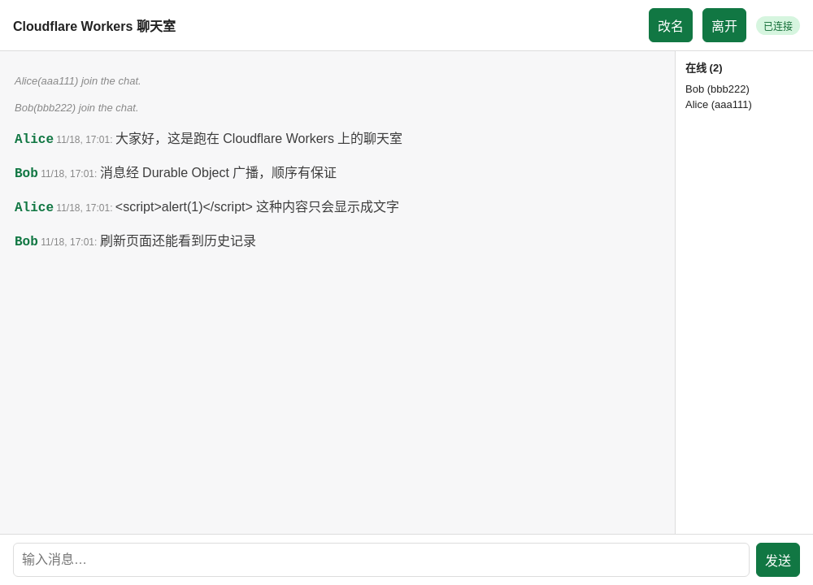
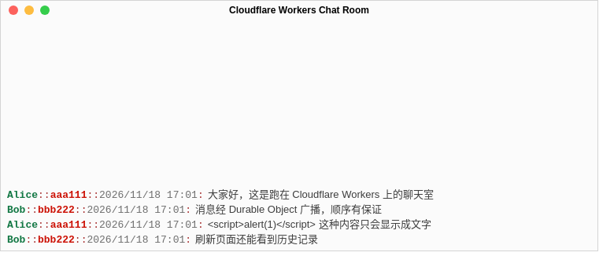

# Cloudflare Workers 聊天室

以 [journey-ad/chat-room](https://github.com/journey-ad/chat-room) 为参考的实时 Web 聊天室，
服务端由 Node.js / Express / Socket.IO / Mongoose 改写为 **Cloudflare Workers + Durable Objects**。

本项目借鉴了参考项目的页面结构、消息流程与交互设计（完整对照见文末「从参考项目借鉴 / 为 Workers 调整」）。
参考项目采用 [MIT 许可证](https://github.com/journey-ad/chat-room/blob/master/LICENSE)，
版权归 2020 journey.ad 所有；其许可证全文随本项目附在 [`LICENSE.upstream`](LICENSE.upstream)。
本项目自身的改写代码以 [GPL-3.0](LICENSE) 发布，两者并存、互不覆盖。

- 前端：昵称进入、连接状态、消息列表、消息输入框、在线列表、改名 / 离开
- 传输：原生 WebSocket（Hibernation API），支持断线自动重连
- 房间：参考项目的命名房间 `/room/@name`，每个房间一个 Durable Object
- 附加：加入 / 离开 / 改名系统消息、历史记录 `/record`、SVG 实时图表、词库过滤

## 项目结构

```
cloudflare-chat-room/
├── wrangler.toml                 # Worker、DO 绑定与 SQLite 迁移
├── package.json / tsconfig.json
├── src/
│   ├── index.ts                  # Worker 路由、WebSocket 升级代理、静态页与 SVG 出口
│   ├── chatRoom.ts               # ChatRoom Durable Object：连接管理、广播、持久化
│   ├── types.ts                  # Env / 协议类型
│   ├── validation.ts             # 校验、转义、词过滤、频率限制（纯函数，可测）
│   ├── banwords.ts               # 起步词表（可替换为上游完整词库）
│   ├── svg.ts                    # 聊天记录 → SVG（foreignObject）
│   └── ui/page.ts                # 自包含页面（内联 CSS/JS）
├── docs/*.png                    # 页面与 SVG 图表截图
├── test/validation.test.ts       # node:test 单元测试
├── scripts/smoke.mjs             # 端到端冒烟测试（仅用 Node 内置 WebSocket）
└── docs/superpowers/             # 设计文档与实施计划
```

## 界面

实时房间（两个浏览器标签互通，右侧为在线列表）：



同一个房间的 SVG 实时图表（`/room/@:roomId/svg?theme=light`，可直接当图片嵌入）：



## 本地运行

```bash
npm install
npm run dev          # wrangler dev，默认 http://localhost:8787
```

打开 <http://localhost:8787/room/@demo>，开第二个标签页（或隐私窗口）即可看到两人互通。
改名、离开、刷新后历史仍在（历史存在 Durable Object SQLite 中）。

其他命令：

```bash
npm test             # 单元测试（校验 / 转义 / 词过滤 / 限流）
npm run typecheck    # tsc --noEmit
node scripts/smoke.mjs http://localhost:8787   # 端到端冒烟测试
```

## 部署到 Cloudflare

```bash
npx wrangler login     # 浏览器授权
npm run deploy         # 等价于 wrangler deploy
```

`wrangler.toml` 已经包含部署所需的全部配置：

```toml
name = "cloudflare-chat-room"
main = "src/index.ts"
compatibility_date = "2026-04-07"

[[durable_objects.bindings]]
name = "CHAT_ROOM"
class_name = "ChatRoom"

[[migrations]]
tag = "v1"
new_sqlite_classes = ["ChatRoom"]
```

- `compatibility_date = "2026-04-07"` 起运行时自动回复 WebSocket close 帧（`web_socket_auto_reply_to_close`），
  `webSocketClose` 里不需要再 `ws.close()`。
- `new_sqlite_classes` 必须使用迁移（migration）声明，首次部署会创建 SQLite 后端；
  后续新增 DO 类需要递增 `tag`（例如 `v2`）。
- 部署后访问 `https://<worker-name>.<subdomain>.workers.dev/room/@demo`。

## 接口

| 路由 | 说明 |
| --- | --- |
| `GET /` | 302 到 `/room/@demo` |
| `GET /room/@:roomId?title=` | 聊天室页面 |
| `GET /ws?room=&name=&uid=&title=` | WebSocket 升级（缺少 `Upgrade` 头返回 426） |
| `GET /room/@:roomId/record?limit=&offset=` | 历史消息 JSON（`limit` 1–100） |
| `GET /room/@:roomId/svg?width=&height=&limit=&theme=&title=&fontSize=` | 最近消息渲染成的 SVG 图 |
| `GET /filter?q=` | 转义后的纯文本（对齐参考项目的调试接口） |
| `GET /health` | `alive` |

WebSocket 协议（JSON）：

```jsonc
// 客户端 → 服务端
{ "type": "message", "text": "hi", "namecolor": "#117743", "msgcolor": "#3d3d3d" }
{ "type": "rename", "name": "新昵称" }
{ "type": "leave" }

// 服务端 → 客户端
{ "type": "init",   "you": {...}, "users": [...], "recent": [...], "roomId": "demo", "title": "" }
{ "type": "msg",    "message": { "id": 1, "uid": "aa1111", "name": "Alice", "text": "hi", "ts": 1794991363, "namecolor": "#117743", "msgcolor": "#3d3d3d" } }
{ "type": "sys",    "text": "Alice(aa1111) join the chat.", "ts": 1794991363 }
{ "type": "online", "users": [...] }
{ "type": "rename", "uid": "aa1111", "name": "新昵称" }
{ "type": "error",  "text": "发送太快了，请稍后再试。" }
```

`ts` 是 Unix **秒**。页面用 `Intl.DateTimeFormat` 按**访问者本地时区**显示；
SVG 是服务端生成、会被当作图片缓存，所以固定用 `Asia/Shanghai`（对齐参考项目 `add(8, 'hours')` 的做法）。

匿名进入时（不带 `name`）服务端会生成 `user_xxxxx` 昵称，避免所有人重名。

## 为什么用 Durable Objects

Worker 的每次请求都跑在相互隔离的上下文中，**无法**在进程内保存一个跨连接的 socket 表；
而聊天室天然需要一个“单一协调点”来保证：同一房间的消息顺序、成员表一致、广播只发一次。
Durable Object 正好提供每房间一个单线程实例 + 内置 WebSocket 接管 + 持久化存储，
配合 Hibernation API 空闲时退出内存（不产生 duration 计费），收到消息再自动唤醒。
连接级的昵称/限流状态放在 `WebSocket.serializeAttachment()` 里，休眠后依然可恢复。

替代方案及其取舍：

| 方案 | 问题 |
| --- | --- |
| Workers KV / D1 轮询 | 不是推送，延迟与读取成本都不可接受 |
| 外部 Redis Pub/Sub（如 Upstash） | 需要额外服务与密钥；跨区域一致性弱；仍要自己实现成员表 |
| 单一全局 DO + 分房间路由 | 房间多时成为热点；按房间分片（本项目做法）天然水平扩展 |
| WebSocket 直连 Worker + Durable Object 仅存状态 | 迁移/重启时连接会丢，Hibernation 不可用 |

## 安全设计

- **房间 ID**：`^[A-Za-z0-9_-]{1,32}$`，非法直接 400，且校验发生在创建 DO stub **之前**（不为无效请求付费）。
- **昵称**：去掉控制字符、trim、最多 32 字（对齐参考项目）；为空则生成 `user_xxxxx`；
  与参考项目一致，昵称同样过词过滤。
- **消息**：trim、非空、最多 1000 字（对齐参考项目上限）。
- **颜色**：`^#(?:[0-9a-fA-F]{3,4}){1,2}$`，否则回落 `#117743` / `#3d3d3d`，避免 CSS 注入。
- **XSS**：服务端对昵称与消息只做词过滤，**原样存储**；所有输出边界各自转义 ——
  页面用 `textContent` 渲染（`innerHTML` 出现 0 次），SVG 出口用 `escapeXml`，
  `title` 等属性值同样转义。这样 DOM 与 SVG 两条路径都不会执行注入内容，
  也避免了"先转义再 `textContent`"导致用户看到 `&lt;` 的二次编码问题。
  已用真实浏览器验证：发送 `` 与 `<script>` 后，
  页面无新增元素、无脚本执行，仅按纯文本显示。
- **频率限制**：滑动窗口 20 条 / 10 秒（每连接，状态存 attachment），超限回 `error` 并丢弃；
  改名 1 次 / 5 秒。
- **参数钳制**：`/record` 的 `limit` 1–100、`offset` ≥ 0；SVG 的宽高/字号/条数都做上限与绝对值处理。
- **缓存**：所有响应 `Cache-Control: no-store`。

局限：`uid` 由客户端提供（与参考项目一致），因此身份可伪造——本实现定位是**公开匿名聊天室**，不做认证。
频率限制按连接计，重连可重置，属于"防误触/低成本刷屏"级别的轻量防护，不是抗攻击方案。

## 从参考项目借鉴 / 为 Workers 调整

**直接借鉴**

| 功能点 | 参考项目位置 |
| --- | --- |
| 命名房间 `/room/@:roomId`，根路径重定向到 `@demo` | `router/room.js`、`index.js` |
| 昵称 + 随机 uid，同 uid 复用身份 | `index.js` 连接处理 |
| `join` / `leave` / `rename` 系统消息与在线列表 | `index.js` `sys` / `online` 事件 |
| `init` / `sys` / `online` / `msg` 事件词汇与载荷形状 | `index.js` |
| 名字 32 字、消息 1000 字上限 | `index.js` `substring(0, 32)` / `substring(0, 1000)` |
| 昵称/文字颜色 + 十六进制校验与默认色 | `index.js` `REGEX_HEX_COLOR` |
| 词过滤 + XSS 清洗流水线 | `utils/filter.js`、`index.js` `processInput` |
| 历史记录接口 `/room/@:roomId/record` | `router/room.js` |
| SVG 实时图表（`foreignObject`、`theme/title/fontSize`） | `utils/record2svg.js`、`router/room.js` |
| `/filter`、`/heart-beat` 辅助接口 | `index.js` |
| 页面三段式：消息区 + 在线列表 + 输入框 | `views/room.ejs` |

**因运行环境调整**

| 参考项目 | Workers 实现 | 原因 |
| --- | --- | --- |
| Express `app.get` 路由 | `src/index.ts` 的 `fetch` 显式路由 | Workers 无 Express 中间件栈 |
| Socket.IO（自定义握手、房间、自动重连） | 原生 WebSocket + 自写重连退避 | Workers 不跑 Socket.IO 服务端；原生 WS 传 `Upgrade` 即可 |
| 进程内 `roomList` 对象 | DO 实例 + `getWebSockets()` + attachment | 请求间无共享内存；休眠会清空内存 |
| Mongoose / SQLite 文件 | Durable Object SQLite（`ctx.storage.sql`） | 无文件系统；DO 存储天然按房间分区 |
| EJS 模板 | `src/ui/page.ts` 返回自包含 HTML | 无模板引擎依赖，单文件部署 |
| Cookie 存 `name` / `uid` | `localStorage` | 前端静态化，无需服务端 cookie 解析 |
| `xss` npm 包 | 本地 `escapeHtml` / `escapeXml` | 避免 Node 依赖；输出边界转义更可控 |
| 148 KB `banword.json` | `src/banwords.ts` 起步词表 | 控制包体；README 说明如何换回完整词库 |
| `moment` 时间格式化 | `Intl.DateTimeFormat` | 运行时内置，无需依赖 |
| SVG 里对单房间的特例替换 | 移除 | 与通用功能无关的彩蛋 |

**未实现（与原项目的差异）**：精确复刻 2020 年的 CSS 主题、认证/私聊、图片消息、
上游完整敏感词库、SVG 图表中针对某个特定房间的词替换彩蛋。

## 换成完整敏感词库

```bash
curl -sS https://raw.githubusercontent.com/journey-ad/chat-room/master/utils/banword.json -o /tmp/banword.json
node -e "const w=require('/tmp/banword.json');require('fs').writeFileSync('src/banwords.ts','export const BANWORDS: readonly string[] = '+JSON.stringify(w)+';\n')"
npm run deploy
```

注意：完整词库约 148 KB，会增大 Worker 打包体积，且上游词表包含大量时政词汇——
公开部署前请自行评估合规性，按需裁剪。
